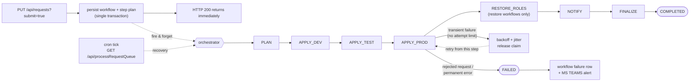
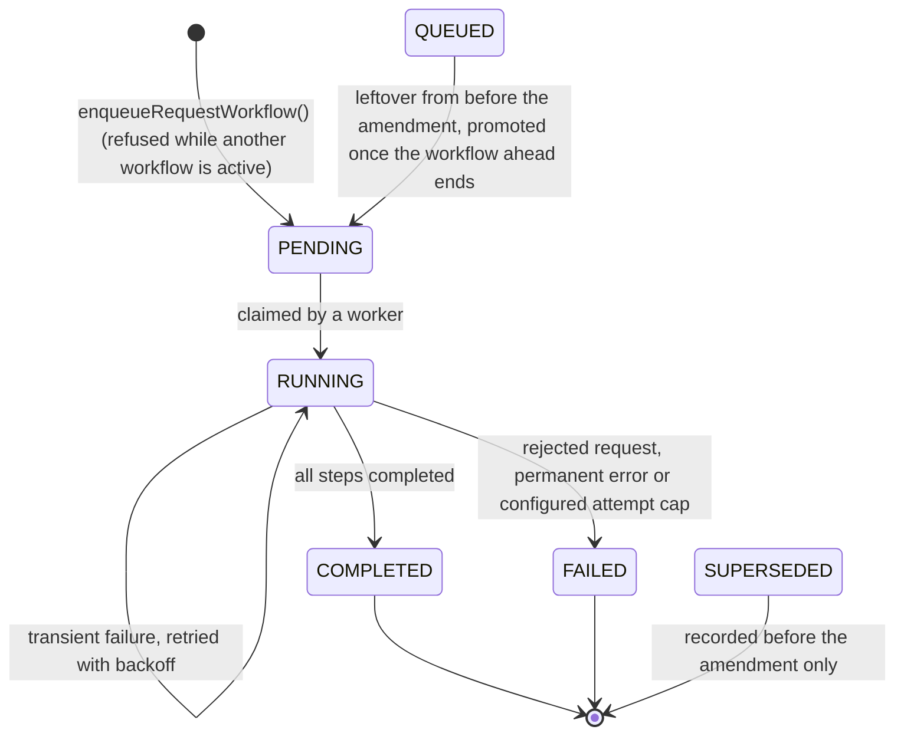
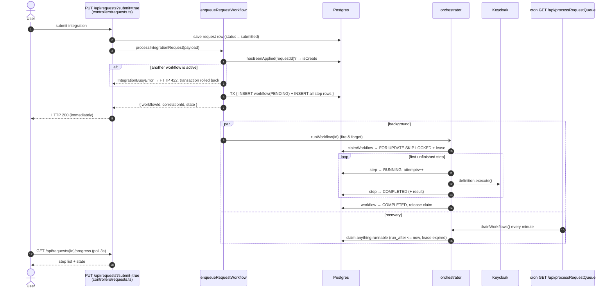
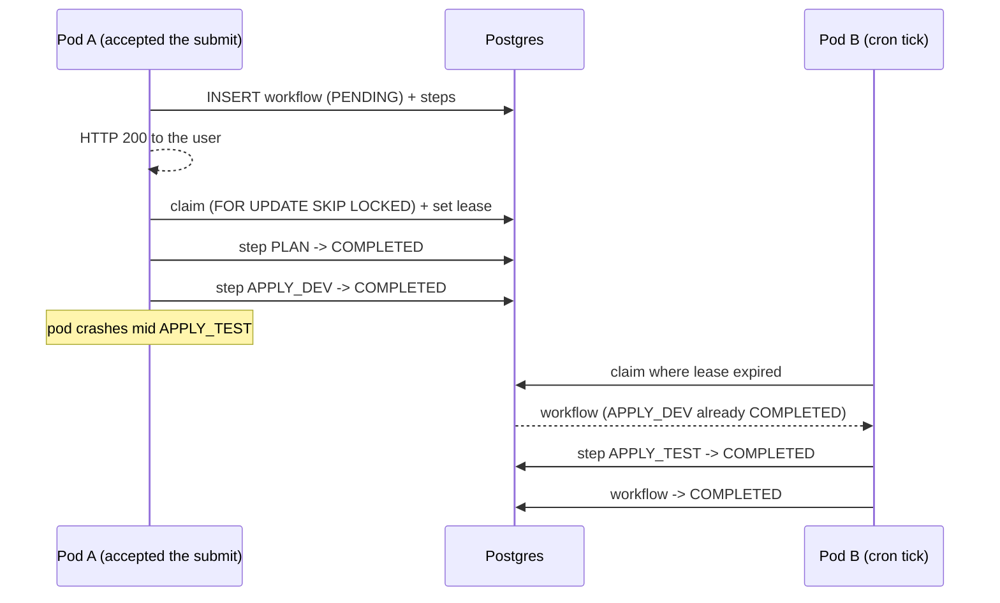
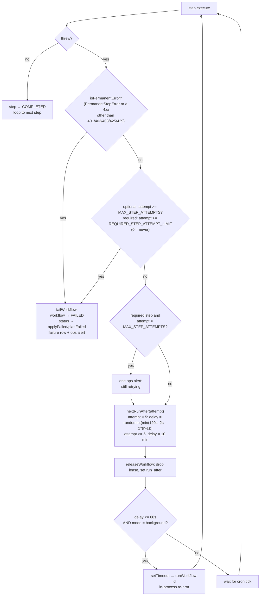

# ADR 0001: Asynchronous integration submission via a Postgres-backed workflow (SAGA Pattern)

- **Status:** Accepted
- **Date:** 2026-09-15
- **Supersedes:** the synchronous integration request processing
- **Amended:** 2026-11-27 — an integration has at most one active workflow; concurrent submissions are refused
  instead of queued, and deletes no longer supersede in-flight workflows

## Context

When a user submitted an integration request, `updateRequest` called `processIntegrationRequest` →
`standardClients` **inside the HTTP request/response cycle**. That function then awaited `keycloakClient(env, ...)` for every environment, then updated
the request status and sent email — all before the browser got a response.

Problems with that design:

1. **The user waited.** A submission touching three environments performs dozens of Keycloak admin
   calls (client create/update, IdP, client scopes, protocol mappers, roles, plus BCSC and Entra
   provisioning). Slow or degraded Keycloak meant a spinning browser tab and, eventually, a gateway
   timeout even though the work was still running server-side. This worsened when user opted for BC
   Services Card or BCGOV IDIR, which initiated more calls to setup a client at the IDP.
2. **Failure state was coarse.** All environments were applied with `Promise.all`; a single failure
   collapsed to `status = 'applyFailed'` with no record of _which_ environment or _which_ operation
   failed.
3. **Recovery was blunt.** `retryFailedRequests` (cron, every 5 min) re-ran **every** environment
   for a queued item, re-doing work that had already succeeded, with a flat retry counter and no
   backoff.
4. **No user-visible progress.** The dashboard showed an indefinite spinner until the row flipped to
   `applied`.

## Decision

Submission is handed to a **workflow orchestrator** whose state lives in Postgres. The HTTP handler
persists the workflow and returns immediately; execution happens in the background and the user
watches it on the dashboard.

We deliberately chose a **forward-only workflow**: there are no compensating actions. When a step fails
it is retried _from that step_; work that already succeeded is left in place.

### Flow

### Workflow lifecycle

### End to End flow

### Claiming and recovery across pods

### Retries

## Design rules

### 1. Idempotency and de-duplication

- Each workflow carries a `requestWorkflowId` (UUID primary key) and a `correlationId`.
- **Step rows are the idempotency ledger.** `request_workflow_steps` has a unique
  `(request_workflow_id, name)` constraint; a step already in `COMPLETED` is skipped on replay, so re-delivering
  the same command is a safe no-op.
- A **partial unique index** allows only one _claimable_ workflow per integration:
  `CREATE UNIQUE INDEX ... ON request_workflows (request_id) WHERE state IN ('PENDING','RUNNING',...)`.
- **One active workflow per integration.** A submission, resubmit, restore or delete that arrives while
  a workflow is `QUEUED`, `PENDING` or `RUNNING` is refused with `IntegrationBusyError` (HTTP 422, "Another
  update or deletion of this integration is in progress"). The refusal rolls back the caller's
  transaction, so the change, the workflow and its `requested` audit event are all discarded and the user
  retries once the workflow ends. The request status already marks the integration in flight
  (`submitted`/`planned`), so `authorizeTransition` refuses with the same error before any work is done.
- Update and resubmit re-load the integration under `SELECT ... FOR UPDATE` in the transaction that
  enqueues, and an update is refused if the row changed (`updatedAt`) since it was validated, so a
  concurrent delete or update is never overwritten by a stale snapshot.
- Row locks cannot block an insert of a row that does not exist yet, so two pods racing the very first
  submit can both try to insert. The unique index lets one through; the other is refused as busy.
- `QUEUED` rows are no longer created. Rows left over from before the amendment still count as active
  and are promoted when the workflow ahead ends.
- Audit events are written through `emitWorkflowEventOnce`, which stamps `details.requestWorkflowId` and checks for
  an existing row first, so a crash between the event insert and the step commit cannot duplicate
  the change history.
- `keycloakClient` was already a converge-to-desired-state operation (find-or-create for the client,
  roles, scopes and mappers), which is what makes re-running a partially applied step safe.

### 2. Explicit state persistence

- Nothing executes until the workflow **and its full step plan** are committed in one transaction.
- The step plan is rebuilt deterministically from the persisted `payload` + `context`
  (`buildRequestWorkflowSteps`), so a pod can resume a workflow another pod started.
- Every transition (`PENDING → RUNNING`, step `RUNNING → COMPLETED`, retry scheduling, terminal
  state) is written **before** the corresponding side effect is attempted.

### 3. Forward-only failure handling (no rollback)

Compensating actions were evaluated and rejected. Rolling back an integration update means deleting
or reverting Keycloak clients that may already be serving live logins; the blast radius of a bad
rollback is worse than the partial state it repairs. Instead:

- A failed step is retried from exactly that step. Completed steps are never re-run or undone.
- **A required step has no attempt limit.** A transient failure (no response, a 5xx, a timeout, or a
  401/403/408/409/425/429) is retried until Keycloak or SDX recovers, and the workflow then
  completes on its own: nobody resubmits. The integration stays in flight, and refuses other
  submissions, for as long as that takes. `WORKFLOW_REQUIRED_STEP_ATTEMPT_LIMIT` sets a hard cap if one is
  ever needed.
  A 409 counts as transient because here it is a race between converging writers, not a bad request: two
  integrations creating the same realm-wide SDX scope, or a retry creating the client that a timed-out
  attempt is still creating. The next attempt finds what the other created.
- A **rejected request** — any other 4xx, found on the error or anywhere in its `cause` chain — a **bug in
  our own code** (`TypeError` or `ReferenceError`, except the `TypeError: fetch failed` Node raises for a
  dropped connection), or a `PermanentStepError` fails the workflow on that attempt, because retrying would
  return the same answer. The workflow moves to the terminal `FAILED` state and the request becomes
  `applyFailed` (`planFailed` if the `PLAN` step failed), in one transaction.
- Operators re-drive a failed workflow by resubmitting, which is only accepted once the workflow has
  failed (`planFailed` / `applyFailed`). A workflow still in flight is left to the engine's own retries.
- **An administrator can stop a workflow that will never finish on its own** (Stop Workflow in the admin
  dashboard, `POST /api/requests/[id]/stop-workflow`). It ends `FAILED`, the integration `applyFailed` or
  `planFailed`, with a failure outcome, a dead letter, an ops alert, and a `request-status-update` event
  recorded as the administrator, so the owner can resubmit once the cause is fixed. A worker still running
  one of its steps finishes that step, sees the workflow is no longer active and leaves it; `FINALIZE` checks
  the same thing under the integration's lock before marking it `applied`. A workflow whose `FINALIZE` has
  already recorded success is refused, since it completes on its own.

### 4. Resiliency and fault tolerance

- **Two-speed retries** (`backoffDelayMs`), persisted as the workflow's `run_after`. The first
  `MAX_STEP_ATTEMPTS` attempts back off exponentially with full jitter (up to 2s, 4s, 8s, 16s), which rides
  out a blip in seconds; jitter keeps every pod that failed against the same Keycloak outage from retrying in
  lockstep. From then on the step is treated as an outage and retried every `SLOW_RETRY_INTERVAL_MS`
  (10 minutes), which the cron tick picks up, so in practice 10–11 minutes apart.
- **`SELECT ... FOR UPDATE SKIP LOCKED`** claims plus a **lease** (`claimed_by` / `claimed_at`)
  guarantee a single owner per workflow and make a workflow abandoned by a crashed pod claimable again once
  the lease expires. A heartbeat refreshes the lease during long steps so it is not stolen mid-flight,
  and only while this worker still owns a claimable workflow.
- **Every step is bounded by `WORKFLOW_STEP_TIMEOUT_MS`.** Without it a Keycloak call that never
  returns would be kept alive by its own heartbeat forever: never retried, never failed, never dead
  lettered. A timeout is raised as a `TransientStepError` so it retries with the normal backoff.
- A delete is refused, for every role, while a workflow for the integration is in flight; it no longer
  supersedes it. The orchestrator still re-reads the workflow state before each step and stops a
  workflow that is no longer claimable, which covers rows superseded before the amendment.
- **Every call to Keycloak, SDX and BCSC has its own timeout** (`EXTERNAL_REQUEST_TIMEOUT_MS`, 30s), so a
  dependency that accepts the connection but never answers fails the call fast instead of holding the step
  for the full step timeout. The two calls that create something on every request — the SDX access-request
  POST and BCSC client registration — are left to the step timeout instead, because giving up on a slow one
  and retrying would create a second.
- **SDX is sent an access request once.** SDX opens a new one for every POST, so the moment it accepts, the
  `SDX_SUBMIT` step stores what it accepted on its own row. A retry of the Keycloak scope sync that follows
  records that submission locally if it is missing and does not POST again.
- Retries shorter than `IN_PROCESS_RETRY_CEILING_MS` are re-armed with an in-process timer; anything
  longer (and anything lost to a restart) is picked up by the cron tick.
- **A pod shutting down hands its workflows over between steps.** On SIGTERM it stops claiming and starts no
  further step; a workflow it is running releases its claim when the current step ends, so the next tick runs
  it elsewhere. A step still running when the process exits is picked up once its lease (2 minutes) expires.
- Failed workflows are written to `request_workflow_failures` and raise a Rocket.Chat ops alert. A
  required step that has failed `MAX_STEP_ATTEMPTS` times raises one "keeps retrying" alert and carries on.
  Steps marked `optional` (currently `NOTIFY`) give up after `MAX_STEP_ATTEMPTS` and become `SKIPPED` instead of
  failing the workflow, because the Keycloak clients are already applied by then. `NOTIFY` runs before
  `FINALIZE`, so the integration reads as `applied`, and accepts new submissions, only once the workflow
  has nothing left to do.

### 5. Code quality and observability

- No nested try/catch: the orchestrator is an explicit loop over a persisted step plan
  (`runNextStep` / `execute`), with step bodies declared as data in `steps/integration.ts`.
- Structured JSON logging (`app/workflow/logger.ts`) with the `correlationId` propagated across every
  async boundary, plus duration metrics per step and per workflow.
- The `correlationId` is surfaced to the user on failure so support can join the UI report to the
  server logs.

## Consequences

### Data model

Three new tables (`db/src/migrations/2026.09.15T10.00.00.create-request-workflow-tables.ts`):

| Table                       | Purpose                                                                                            |
| --------------------------- | -------------------------------------------------------------------------------------------------- |
| `request_workflows`         | One row per workflow: state, payload snapshot, context, claim/lease, `run_after`, `correlation_id` |
| `request_workflow_steps`    | The persisted plan and the idempotency ledger; unique on `(request_workflow_id, name)`             |
| `request_workflow_failures` | Unrecoverable workflows awaiting manual intervention                                               |

Other migrations:

- `2026.09.15T10.10.00.drop-request-queues-table` — drops `request_queues`. The `RequestQueue`
  sequelize models were deleted from both `app/` and `api/`.
- `2026.09.17T10.00.00.add-queued-workflow-index` — the one-queued-follow-up-per-integration index.

No change to `requests.status` was needed. An earlier revision added a `processing` label to the
`enum_requests_status` type, but `ALTER TYPE ... ADD VALUE` requires **ownership** of the type, and
ownership cannot be granted with `GRANT`. In OpenShift the type is owned by the role that
bootstrapped the database, not by the migration user, so the migration failed with
`must be owner of type enum_requests_status`. The label was purely cosmetic — the request sits on
`planned` for the duration of the apply, which every status guard and `getStatusDisplayName` already
treat identically — so the dependency was removed rather than worked around.

> Adding a value to `requests.status` therefore requires a DBA to run
> `ALTER TYPE "enum_requests_status" OWNER TO <migration_role>` first. Prefer deriving new UI state
> from `request_workflow_steps` instead.

### Request status transitions

`submitted → planned → applied`, or `→ planFailed` / `→ applyFailed` on terminal failure. Live
progress during the apply comes from `request_workflow_steps` via the progress endpoint, not from
`requests.status`.

### Code layout

| Path                                | Responsibility                                                                               |
| ----------------------------------- | -------------------------------------------------------------------------------------------- |
| `app/workflow/types.ts`             | `WorkflowState`, `StepState`, `WorkflowContext`, `PermanentStepError` / `TransientStepError` |
| `app/workflow/backoff.ts`           | Retry limits, lease window, exponential backoff with jitter                                  |
| `app/workflow/logger.ts`            | Structured logging with correlation-id propagation                                           |
| `app/workflow/store.ts`             | Persistence, `SKIP LOCKED` claiming, leases, dead letters                                    |
| `app/workflow/steps/integration.ts` | The step definitions (`PLAN`, `APPLY_<ENV>`, `RESTORE_ROLES`, `NOTIFY`, `FINALIZE`)          |
| `app/workflow/orchestrator.ts`      | The state machine: `runWorkflow(id)`, `drainWorkflows()`                                     |
| `app/workflow/request-worklfow.ts`  | `enqueueRequestWorkflow()`, `getIntegrationProgress()`                                       |
| `app/workflow/effects.ts`           | Side effects moved out of the controller: notifications, role restoration                    |

`updatePlannedIntegration` moved from `app/controllers/requests.ts` to `app/workflow/effects.ts`, and
`createEvent` moved to `app/queries/event.ts`. Controllers import `createEvent` from
`app/queries/event` **directly** — re-exporting it from `controllers/requests.ts` breaks the test
suites that spread `jest.requireActual('@app/controllers/requests')`, because the re-export getter
is evaluated while the module graph is mid-cycle.

### Flows that changed

| Flow                               | Behaviour                                                                                                                            |
| ---------------------------------- | ------------------------------------------------------------------------------------------------------------------------------------ |
| Submit / update integration        | Asynchronous                                                                                                                         |
| Delete integration                 | Asynchronous; refused while a workflow for that integration is in flight                                                             |
| Restore integration                | Asynchronous; role re-creation and the restore email became workflow steps so they only run once the Keycloak clients exist again    |
| Resubmit                           | Now means "retry the workflow"; accepted only from failed statuses, refused while a workflow is in flight                            |
| Team and organization API accounts | Still synchronous via `{ awaitCompletion: true }`, because the caller reads the client credentials immediately afterwards; see below |

API accounts wait for their workflow for at most `WORKFLOW_AWAIT_COMPLETION_BUDGET_MS` (45s, well under the
route's 180s timeout). Once the next retry falls beyond that, Keycloak is having an outage rather than a blip,
and the account is returned as still in progress instead of failing: the dashboard polls it, and it completes
on its own. Only a workflow that ended `FAILED` is a 422. Deleting an API account is refused while any
workflow for it is active, and goes through a delete workflow whenever an earlier apply was attempted, even one
that never recorded an outcome, since it may have created a client.

### User interface

- New endpoint `GET /api/requests/[id]/progress`, authorized with the same rules as the integration
  itself, returning the workflow projection (`app/interfaces/WorkflowProgress.ts`).
- `app/components/SubmittedStatusIndicator.tsx` renders the live step list — progress bar, per-step
  spinner/check/cross, and on failure the failed step plus contact-the-SSO-team guidance quoting the
  correlation id. There is no retry button by design.
- `IntegrationInfoTabs` polls every 3 seconds. **While the workflow is active the progress tab is the
  only tab** (nothing is configured yet, so Technical Details would be misleading). Once the workflow
  completes the tab disappears; if it failed, the tab stays alongside the other tabs.

### Operations

- `GET /api/processRequestQueue` now calls `drainWorkflows()` — the recovery tick that re-claims workflows
  waiting on backoff, never started, or abandoned by a crashed pod. The cron schedule moved from
  every 5 minutes to every minute. Every retry longer than a minute depends on it, so the cron checks each
  response: a failure (anything but 2xx, or no response) is logged, and three in a row post an ops alert to
  `RC_SSO_OPS_WEBHOOK`, with a second message once it succeeds again. A 504 means the route stopped waiting on
  a tick that is still working and is not counted.
- Tuning knobs (all optional):

  | Variable                               | Default      | Meaning                                                                                                    |
  | -------------------------------------- | ------------ | ---------------------------------------------------------------------------------------------------------- |
  | `WORKFLOW_MAX_STEP_ATTEMPTS`           | `5`          | Attempts before an optional step is skipped, and before ops is alerted that a required step keeps retrying |
  | `WORKFLOW_REQUIRED_STEP_ATTEMPT_LIMIT` | `0`          | Hard cap on a required step's attempts; `0` retries until the dependency recovers                          |
  | `WORKFLOW_CLAIM_LEASE_SECONDS`         | `120`        | Lease window before a claim is considered abandoned; renewed every third of it while a step runs           |
  | `WORKFLOW_RETRY_BASE_DELAY_MS`         | `2000`       | Backoff base                                                                                               |
  | `WORKFLOW_RETRY_MAX_DELAY_MS`          | `120000`     | Backoff ceiling                                                                                            |
  | `WORKFLOW_SLOW_RETRY_INTERVAL_MS`      | `600000`     | Fixed interval between retries once a step has failed `WORKFLOW_MAX_STEP_ATTEMPTS` times                   |
  | `WORKFLOW_IN_PROCESS_RETRY_CEILING_MS` | `60000`      | Above this, retries wait for the cron tick                                                                 |
  | `WORKFLOW_STEP_TIMEOUT_MS`             | `300000`     | Ceiling on a single step before it is retried                                                              |
  | `WORKFLOW_AWAIT_COMPLETION_BUDGET_MS`  | `45000`      | How long an API account request waits for its workflow before returning it as in progress                  |
  | `EXTERNAL_REQUEST_TIMEOUT_MS`          | `30000`      | Ceiling on one call to Keycloak, SDX or BCSC (not the SDX POST or BCSC registration)                       |
  | `RECOVERY_TICK_FAILURES_BEFORE_ALERT`  | `3`          | Cron only: failed recovery ticks in a row before ops is alerted                                            |
  | `WORKFLOW_EXECUTION_MODE`              | `background` | `background` \| `synchronous` \| `manual` (see below)                                                      |

### Testing

`WORKFLOW_EXECUTION_MODE` makes execution explicit rather than inferred from `NODE_ENV` (which the API
suite sets to `development`):

- `background` — production. Kick off in-process, cron recovers.
- `synchronous` — run to completion before returning. Set in `app/jest-api/jest.setup.js` so the
  pre-existing API specs still observe the final outcome within the request call.
- `manual` — persist only; the caller drives execution. Used by
  `app/jest-api/17.request-workflow.test.ts`, which covers the happy path, de-duplication,
  idempotent replay, resumption from a failed step, backoff retries, and marking it failed.

`app/jest/submissionProgressTab.test.tsx` covers the tab behaviour.

## Alternatives considered

| Option                                                        | Why not                                                                                                                                                                                                         |
| ------------------------------------------------------------- | --------------------------------------------------------------------------------------------------------------------------------------------------------------------------------------------------------------- |
| Keep `request_queues`, just move execution to the cron        | Progress would be delayed by the tick interval, retries would still re-run every environment, and there would still be no per-step visibility.                                                                  |
| Compensating transactions (classic workflow rollback)         | Deleting or reverting Keycloak clients that may be serving live logins is more dangerous than the partial state it repairs. Rejected in favour of forward-only retry.                                           |
| A dedicated worker service or external queue (Redis/RabbitMQ) | New infrastructure and deployment surface for a workload that Postgres row-level locking handles comfortably at this volume.                                                                                    |
| Decomposing `keycloakClient` into per-resource steps          | Much richer progress, but a significant rewrite of `app/keycloak/integration.ts` with real regression risk. Per-environment granularity was enough for the UI. Revisit if per-resource recovery is ever needed. |
